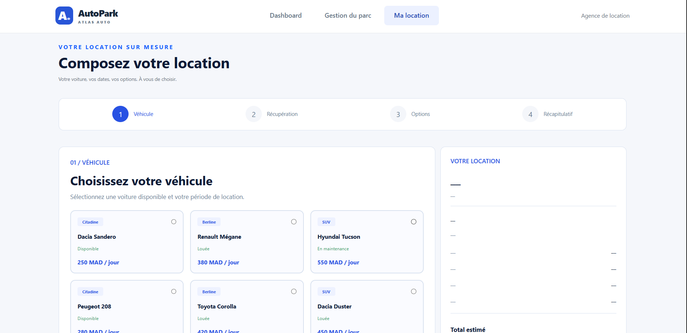
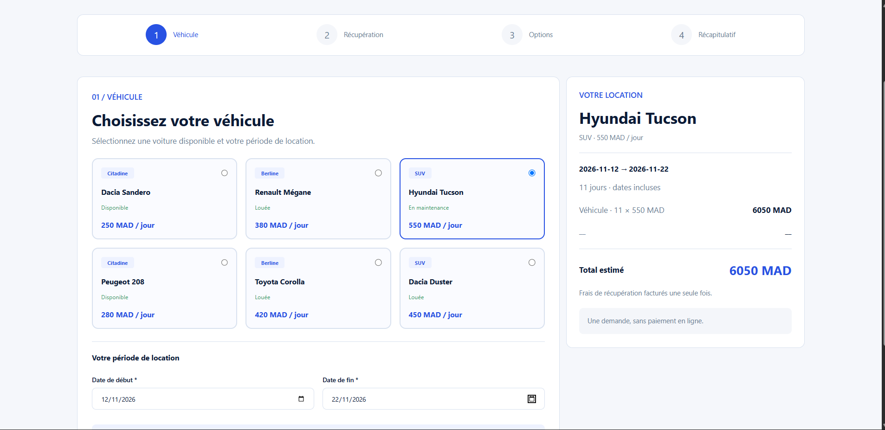
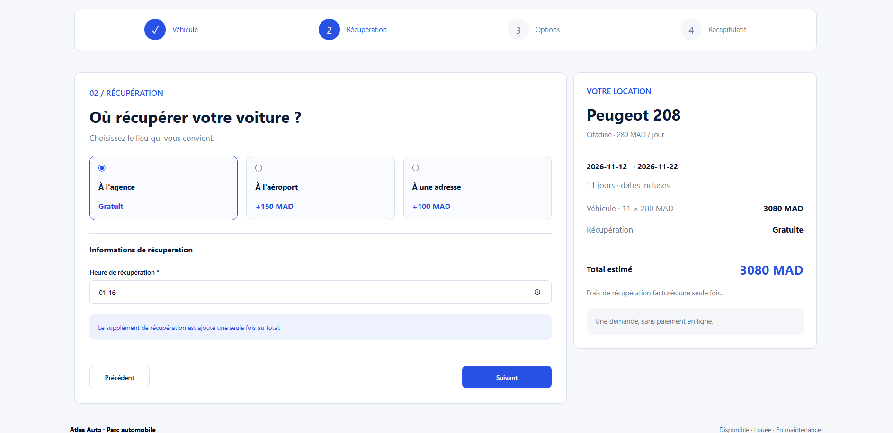
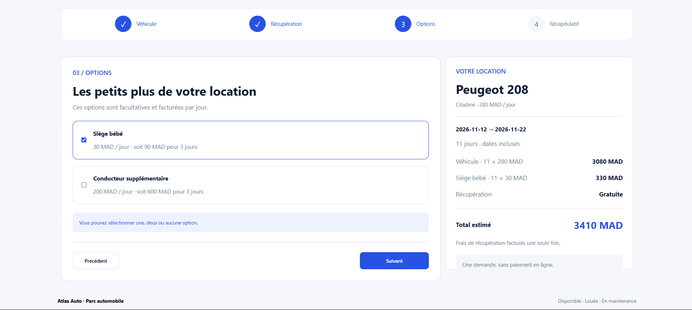
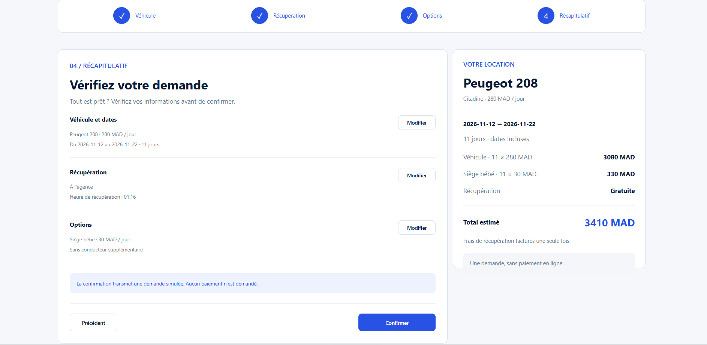
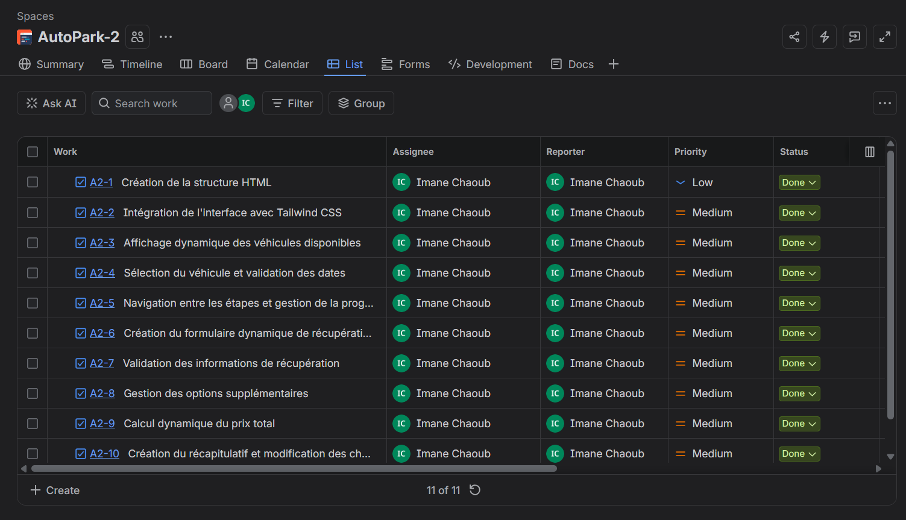

# 🚗 AutoPark — Configurateur de location

AutoPark — Configurateur de location est une application web développée dans le cadre d'un projet individuel à **Simplon / YouCode**.

Ce projet représente la deuxième partie d'AutoPark, une application destinée à **Atlas Auto**, une agence fictive de location de voitures.

Après avoir développé une interface de gestion du parc automobile, cette nouvelle partie permet aux clients de configurer leur location en sélectionnant un véhicule, une période de location, un mode de récupération et des options supplémentaires.

Le montant total est calculé automatiquement en fonction des choix effectués.

L'application fonctionne entièrement côté **frontend**, sans backend ni base de données.

---

## 📸 Aperçu du projet

### Configurateur de location



Le configurateur permet aux utilisateurs de personnaliser leur location à travers plusieurs étapes.

### Sélection du véhicule



L'utilisateur peut consulter les véhicules du parc, sélectionner une voiture et choisir les dates de location.

### Mode de récupération



Le formulaire s'adapte au mode de récupération sélectionné.

### Options supplémentaires



L'utilisateur peut ajouter un siège bébé ou un conducteur supplémentaire.

### Récapitulatif



Cette page permet de vérifier les informations de location avant la confirmation.

---

## 🎯 Objectif du projet

L'objectif principal est de développer un configurateur de location dynamique avec **JavaScript Vanilla ES6+**.

Ce projet permet notamment de pratiquer :

- la manipulation du DOM ;
- la gestion des événements JavaScript ;
- les formulaires dynamiques ;
- la validation des champs ;
- la navigation entre plusieurs étapes ;
- le calcul dynamique des prix ;
- la manipulation des tableaux d'objets ;
- l'utilisation de `localStorage` et `sessionStorage` ;
- la sauvegarde et la restauration des données ;
- les modules JavaScript ES6 ;
- le responsive design avec Tailwind CSS ;
- la gestion de projet avec GitFlow et Jira.

---

## ✨ Fonctionnalités

### 🚘 Sélection du véhicule

L'utilisateur peut :

- consulter les voitures enregistrées dans le parc AutoPark ;
- afficher la marque, le modèle, la catégorie et le prix journalier ;
- sélectionner un véhicule ;
- consulter son statut ;
- choisir les dates de début et de fin de location.

Les véhicules sont récupérés depuis `localStorage`.

Si aucune donnée n'est enregistrée, les données initiales du fichier `data.js` sont utilisées.

### 📅 Gestion des dates

Le configurateur vérifie :

- qu'un véhicule a été sélectionné ;
- que le véhicule est disponible ;
- que la date de début est renseignée ;
- que la date de fin est renseignée ;
- que la date de début n'est pas passée ;
- que la date de fin n'est pas antérieure à la date de début.

Les dates de début et de fin sont incluses dans la durée.

**Exemple :**

Une location du 10 au 12 novembre représente **3 jours**.

### 📍 Modes de récupération

L'utilisateur peut choisir entre trois modes de récupération.

| Mode | Informations demandées | Supplément |
|---|---|---|
| À l'agence | Heure de récupération | Gratuit |
| À l'aéroport | Aéroport, numéro de vol et heure d'arrivée | 150 MAD |
| À une adresse | Ville, adresse complète et heure de livraison | 100 MAD |

Le formulaire change dynamiquement selon le mode sélectionné.

Les champs correspondant aux autres modes sont masqués.

Les frais de récupération sont ajoutés une seule fois au montant total.

### ➕ Options supplémentaires

Deux options facultatives sont proposées :

| Option | Prix |
|---|---|
| Siège bébé | 30 MAD / jour |
| Conducteur supplémentaire | 200 MAD / jour |

L'utilisateur peut sélectionner :

- aucune option ;
- une seule option ;
- les deux options.

Le montant total est actualisé automatiquement après chaque modification.

### 💰 Calcul dynamique du prix

Le prix total dépend :

- du tarif journalier du véhicule ;
- du nombre de jours ;
- des options supplémentaires ;
- du mode de récupération.

**Formule :**

```text
Total = Nombre de jours × (Prix du véhicule / jour
        + Prix des options / jour)
        + Frais de récupération
```

**Exemple :**

Location d'une Dacia Sandero :

```text
Véhicule : Dacia Sandero
Prix journalier : 250 MAD

Durée : 3 jours

Option : Siège bébé
Prix : 30 MAD / jour

Récupération : Aéroport
Frais : 150 MAD

Calcul :
3 × (250 + 30) + 150

Total : 990 MAD
```

Le récapitulatif du prix est actualisé selon les choix effectués.

### 🔄 Navigation entre les étapes

Le configurateur utilise un parcours en plusieurs étapes :

1. Véhicule et dates
2. Récupération
3. Options
4. Récapitulatif
5. Confirmation de la demande

Une seule étape est affichée à la fois.

L'utilisateur peut :

- passer à l'étape suivante ;
- revenir à l'étape précédente ;
- conserver les informations déjà saisies ;
- visualiser sa progression ;
- modifier ses choix depuis le récapitulatif.

### 📝 Validation des formulaires

Les informations sont vérifiées avant le passage à l'étape suivante.

Les contrôles portent notamment sur :

- la sélection d'un véhicule ;
- la disponibilité du véhicule ;
- les dates de location ;
- l'heure de récupération ;
- le choix de l'aéroport ;
- le numéro du vol ;
- l'heure d'arrivée ;
- la ville ;
- l'adresse de livraison ;
- l'heure de livraison.

Des messages d'erreur sont affichés près des champs concernés.

### 📋 Récapitulatif de location

Avant la confirmation, l'utilisateur peut consulter :

- le véhicule sélectionné ;
- le tarif journalier ;
- les dates de location ;
- la durée ;
- le mode de récupération ;
- les informations de récupération ;
- les options sélectionnées ;
- le montant total estimé.

Des boutons **Modifier** permettent de revenir aux étapes précédentes sans perdre les informations.

### ✅ Confirmation de la demande

Une fois les informations vérifiées, l'utilisateur peut confirmer sa demande.

Une page de confirmation est affichée avec un message de réussite.

L'utilisateur peut ensuite commencer une nouvelle location.

La confirmation est simulée côté navigateur, sans paiement en ligne.

### 💾 Persistance des données

Les véhicules du parc sont stockés dans `localStorage`.

La configuration de location est conservée dans `sessionStorage` sous la clé :

```javascript
"location"
```

Les données sont enregistrées et récupérées grâce à :

```javascript
JSON.stringify()
JSON.parse()
```

Les choix sont restaurés après un rafraîchissement de la page dans la même session.

---

## 🛠️ Technologies utilisées

- **HTML5** — structure des pages
- **Tailwind CSS** — design et responsive
- **JavaScript ES6+** — logique du configurateur
- **DOM** — manipulation dynamique des éléments
- **localStorage** — stockage des véhicules
- **sessionStorage** — sauvegarde de la configuration
- **Git** — gestion des versions
- **GitHub** — hébergement du code source
- **GitFlow** — organisation des branches
- **Jira** — planification et suivi des tâches
- **Figma** — conception des maquettes
- **Vercel** — déploiement de l'application

---

## 📁 Structure du projet

```text
AutoPark/
│
├── index.html
├── voitures.html
├── location.html
│
├── css/
│   └── style.css
│
├── js/
│   ├── data.js
│   ├── voitures.js
│   ├── dashboard.js
│   └── location.js
│
├── assets/
│   └── images/
│       ├── dashboard.png
│       ├── gestion-parc.png
│       ├── location.png
│       ├── vehicule.png
│       ├── recuperation.png
│       ├── options.png
│       ├── recapitulatif.png
│       └── jira.png
│
└── README.md
```

### Rôle des fichiers

**`index.html`**

Contient le dashboard de gestion du parc automobile.

**`voitures.html`**

Contient l'interface de gestion des voitures.

**`location.html`**

Contient l'interface du configurateur de location.

**`data.js`**

Contient les données initiales des véhicules.

**`voitures.js`**

Gère les opérations CRUD sur les voitures du parc.

**`dashboard.js`**

Affiche les statistiques et les indicateurs du parc automobile.

**`location.js`**

Contient la logique du configurateur :

- affichage des véhicules ;
- sélection des dates ;
- gestion des étapes ;
- formulaire dynamique de récupération ;
- sélection des options ;
- validation des champs ;
- calcul du prix ;
- récapitulatif ;
- confirmation ;
- sauvegarde de la configuration.

---

## 💾 Gestion des données

Les voitures sont représentées sous forme d'un tableau d'objets JavaScript.

Exemple :

```javascript
{
    id: 1,
    marque: "Dacia",
    modele: "Sandero",
    immatriculation: "AUTO-001",
    categorie: "Citadine",
    prixJour: 250,
    statut: "Disponible"
}
```

Les véhicules sont récupérés depuis `localStorage`.

```javascript
if (!localStorage.getItem("voitures")) {
    localStorage.setItem(
        "voitures",
        JSON.stringify(voituresInitiales)
    );
}

let voitures = JSON.parse(
    localStorage.getItem("voitures")
);
```

Les choix de l'utilisateur sont conservés dans un objet `selectedConfig`.

Cet objet contient notamment :

- l'étape actuelle ;
- l'identifiant du véhicule ;
- les dates de location ;
- le mode de récupération ;
- les informations de récupération ;
- les options sélectionnées.

---

## 🔀 Organisation avec GitFlow

Le développement du projet est organisé avec GitFlow.

### Branches principales

- `main` : version stable du projet
- `develop` : branche d'intégration des fonctionnalités

### Branches de fonctionnalités

Exemples :

```text
feature/layout
feature/vehicle-selection
feature/date-validation
feature/dynamic-form
feature/price-calculation
feature/navigation
feature/recap
feature/storage
feature/responsive
```

Les fonctionnalités sont développées dans des branches dédiées avant leur intégration par Pull Requests.

---

## 📊 Organisation avec Jira

Le projet est organisé avec **Jira** pour suivre les différentes tâches de développement.



Les tâches sont réparties entre :

- planification et initialisation ;
- structure HTML ;
- intégration Tailwind CSS ;
- affichage des véhicules ;
- sélection et validation des dates ;
- navigation entre les étapes ;
- formulaire dynamique de récupération ;
- options supplémentaires ;
- calcul du prix ;
- récapitulatif ;
- sauvegarde des données ;
- confirmation ;
- responsive design ;
- tests et corrections ;
- documentation et déploiement.

Les statuts utilisés sont :

- À faire
- En cours
- En revue
- Terminé

---

## 🚀 Installation et lancement

### 1. Cloner le dépôt

```bash
git clone https://github.com/itsemmax/AutoPark.git
```

### 2. Accéder au projet

```bash
cd AutoPark
```

### 3. Lancer un serveur local

Le projet utilise des modules JavaScript ES6.

Il est recommandé de lancer l'application avec un serveur local, par exemple **Live Server** dans Visual Studio Code.

### 4. Ouvrir l'application

```text
index.html
```

Pour accéder au dashboard.

```text
voitures.html
```

Pour accéder à la gestion du parc.

```text
location.html
```

Pour accéder au configurateur de location.

---

## 🌐 Déploiement

L’application AutoPark est déployée en ligne et accessible via le lien suivant :

🔗 **Application déployée :** [(https://autopark-chi.vercel.app/index.html)]

Le projet contient deux pages principales :

- **Dashboard :** `index.html`
- **Gestion du parc :** `voitures.html`
- **Location :** `location.html`

🔗 **Dépôt GitHub :** [(https://github.com/itsemmax/AutoPark)]
---

## 📱 Responsive Design

L'interface est conçue pour s'adapter aux différents formats d'écran :

- 📱 Mobile
- 📱 Tablette
- 💻 Desktop

Tailwind CSS permet d'adapter :

- la disposition des véhicules ;
- les formulaires ;
- les cartes de récupération ;
- les boutons de navigation ;
- le récapitulatif du prix ;
- les espacements et les tailles des éléments.

---

## 🧠 Compétences développées

Ce projet m'a permis de pratiquer et de renforcer :

- JavaScript Vanilla ES6+ ;
- manipulation du DOM ;
- événements avec `addEventListener()` ;
- gestion des formulaires dynamiques ;
- validation des données ;
- navigation multi-étapes ;
- gestion d'un état avec des objets JavaScript ;
- calcul dynamique des prix ;
- utilisation de `find()` et `forEach()` ;
- sauvegarde avec `JSON.stringify()` ;
- restauration avec `JSON.parse()` ;
- utilisation de `localStorage` et `sessionStorage` ;
- modules ES6 ;
- responsive design avec Tailwind CSS ;
- GitFlow et Pull Requests ;
- organisation des tâches avec Jira.

---

## 👩‍💻 Réalisation

Projet réalisé individuellement dans le cadre de la formation **Développeur Web et Web Mobile**.

**Projet :** AutoPark — Configurateur de location

**Contexte :** Simplon / YouCode

**Durée :** 4 jours

**Date :** Novembre 2026
