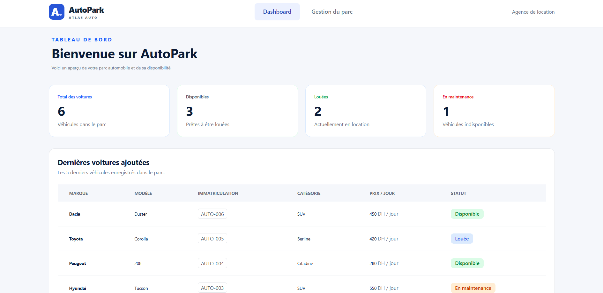
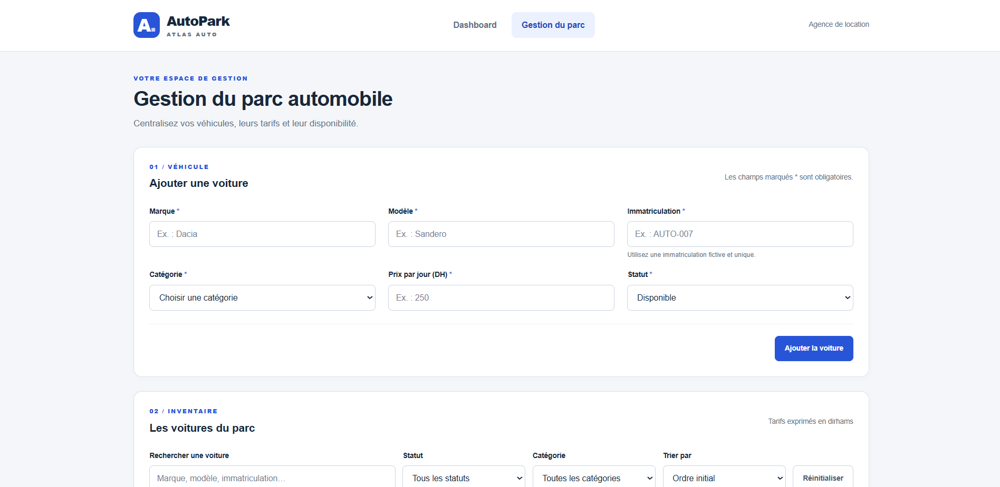
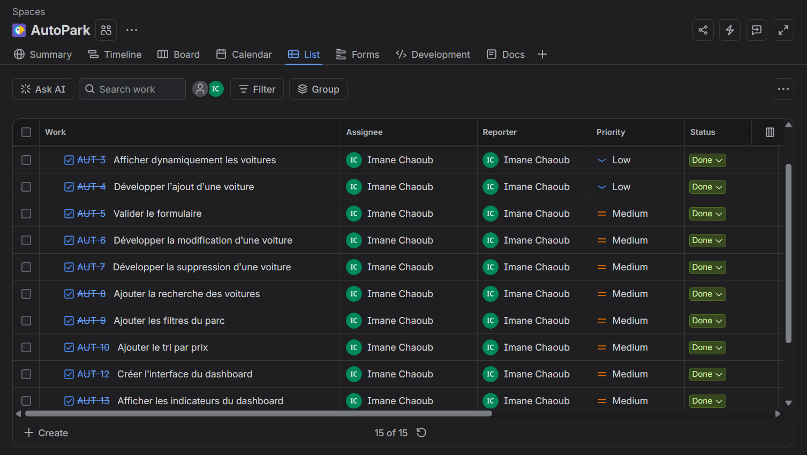

# 🚗 AutoPark — Gestion d’un parc automobile

AutoPark est une application web de gestion d’un parc automobile réalisée dans le cadre d’un projet individuel à **Simplon / YouCode**.

L’application permet à une agence fictive de location de voitures, **Atlas Auto**, de gérer ses véhicules, leurs tarifs et leur disponibilité à travers une interface simple et responsive.

Le projet fonctionne entièrement côté frontend, sans backend ni base de données. Les données sont sauvegardées dans le navigateur grâce à `localStorage`.

---

## 📸 Aperçu du projet

### Dashboard



Le dashboard permet de visualiser rapidement :

- le nombre total de voitures ;
- les voitures disponibles ;
- les voitures louées ;
- les voitures en maintenance ;
- les 5 dernières voitures ajoutées.

### Gestion du parc



La page de gestion permet d'ajouter, modifier, supprimer, rechercher, filtrer et trier les voitures du parc.

---

## 🎯 Objectif du projet

L’objectif principal est de développer une application web permettant de gérer les voitures d’une agence de location en utilisant **JavaScript Vanilla ES6+**.

Ce projet permet notamment de pratiquer :

- la manipulation du DOM ;
- les événements JavaScript ;
- les tableaux d’objets ;
- les opérations CRUD ;
- la validation des formulaires ;
- les méthodes `filter()`, `find()`, `some()`, `sort()`... ;
- les modules ES6 avec `import` / `export` ;
- la sauvegarde des données avec `localStorage` ;
- la création d’une interface responsive.

---

## ✨ Fonctionnalités

### Gestion des voitures

L’utilisateur peut :

- afficher dynamiquement les voitures du parc ;
- ajouter une nouvelle voiture ;
- modifier une voiture existante ;
- annuler une modification ;
- supprimer une voiture après confirmation ;
- conserver un identifiant pour chaque voiture.

Chaque voiture contient :

- une marque ;
- un modèle ;
- une immatriculation ;
- une catégorie ;
- un prix journalier ;
- un statut.

### Validation du formulaire

Le formulaire vérifie notamment :

- les champs obligatoires ;
- la marque et le modèle ;
- le format de l’immatriculation `AUTO-XXX` ;
- l’unicité de l’immatriculation ;
- la catégorie ;
- le prix journalier.

Les erreurs sont affichées directement près des champs concernés.

### Recherche et filtres

Il est possible de rechercher une voiture par :

- marque ;
- modèle ;
- immatriculation.

L’utilisateur peut également filtrer les voitures par :

- statut ;
- catégorie.

Les voitures peuvent être triées selon leur prix :

- prix croissant ;
- prix décroissant.

Un bouton permet également de réinitialiser tous les critères.

### Persistance des données

Les voitures sont sauvegardées dans le navigateur avec :

```javascript
localStorage
```

Les données sont transformées grâce à :

```javascript
JSON.stringify()
JSON.parse()
```

Ainsi, les modifications restent disponibles après le rechargement de la page.

### Dashboard

Le dashboard utilise les mêmes données enregistrées dans `localStorage`.

Il affiche quatre indicateurs principaux :

| Indicateur | Description |
|---|---|
| Total | Nombre total de voitures |
| Disponibles | Voitures disponibles à la location |
| Louées | Voitures actuellement louées |
| En maintenance | Voitures temporairement indisponibles |

Une section affiche également les **5 dernières voitures ajoutées** au parc.

---

## 🛠️ Technologies utilisées

- **HTML5** — structure des pages
- **CSS3** — mise en forme de la page de gestion
- **Tailwind CSS** — interface du dashboard
- **JavaScript ES6+** — logique de l’application
- **DOM** — manipulation dynamique de l’interface
- **localStorage** — persistance des données
- **Git** — gestion des versions
- **GitHub** — hébergement du code source
- **Jira** — organisation et suivi des tâches

---

## 📁 Structure du projet

```text
AutoPark/
│
├── index.html
├── voitures.html
│
├── css/
│   └── style.css
│
├── js/
│   ├── data.js
│   ├── voitures.js
│   └── dashboard.js
│
├── assets/
│   └── images/
│       ├── dashboard.png
│       ├── gestion-parc.png
│       └── jira.png
│
└── README.md
```

### Rôle des fichiers

**`index.html`**  
Contient l’interface du dashboard.

**`voitures.html`**  
Contient l’interface principale de gestion du parc automobile.

**`data.js`**  
Contient les données initiales des voitures fournies au démarrage du projet.

**`voitures.js`**  
Contient la logique principale de gestion : affichage, ajout, modification, suppression, validation, recherche, filtres, tri et `localStorage`.

**`dashboard.js`**  
Récupère les données du `localStorage`, calcule les différents compteurs et affiche les dernières voitures ajoutées.

---

## 💾 Données

Les données initiales sont représentées sous forme d’un tableau d’objets JavaScript.

Exemple :

```javascript
{
    id: 1,
    marque: "Dacia",
    modele: "Sandero",
    immatriculation: "AUTO-001",
    categorie: "Citadine",
    prixJour: 250,
    statut: "Disponible"
}
```

Au premier lancement, les données initiales sont enregistrées dans `localStorage`.

Les opérations suivantes utilisent ensuite les données sauvegardées :

```text
Ajouter
   ↓
Modifier
   ↓
Supprimer
   ↓
localStorage
   ↓
Dashboard
```

---

## 🔄 Opérations CRUD

| Opération | Fonction |
|---|---|
| Create | Ajouter une voiture |
| Read | Afficher les voitures |
| Update | Modifier une voiture |
| Delete | Supprimer une voiture |

Toutes les opérations sont réalisées dynamiquement en JavaScript sans rechargement de la page.

---

## 📊 Organisation avec Jira

Le projet a été organisé avec **Jira** afin de découper le développement en différentes tâches et de suivre leur état d’avancement.



Les tâches ont été réparties entre différentes étapes :

- analyse du brief ;
- initialisation du projet ;
- affichage dynamique des voitures ;
- développement du CRUD ;
- validation du formulaire ;
- gestion du `localStorage` ;
- recherche et filtres ;
- tri des voitures ;
- création du dashboard ;
- responsive design ;
- tests et corrections ;
- documentation et livraison.

---

## 🚀 Installation et lancement

### 1. Cloner le dépôt

```bash
git clone <URL-DU-DEPOT>
```

### 2. Accéder au projet

```bash
cd AutoPark
```

### 3. Lancer un serveur local

Le projet utilise les modules ES6, il est donc recommandé de l’exécuter avec un serveur local.

Avec VS Code, vous pouvez par exemple utiliser **Live Server**.

Puis ouvrir :

```text
index.html
```

pour accéder au dashboard, ou :

```text
voitures.html
```

pour accéder à la gestion du parc.

---

## 🌐 Déploiement

L’application AutoPark est déployée en ligne et accessible via le lien suivant :

🔗 **Application déployée :** [(https://autopark-chi.vercel.app/index.html)]

Le projet contient deux pages principales :

- **Dashboard :** `index.html`
- **Gestion du parc :** `voitures.html`

🔗 **Dépôt GitHub :** [(https://github.com/itsemmax/AutoPark)]
---

## 📱 Responsive Design

L’application est conçue pour rester utilisable sur différents écrans :

- 📱 Mobile
- 📱 Tablette
- 💻 Desktop

Le dashboard utilise notamment une grille responsive afin d’adapter les indicateurs à la largeur de l’écran.

---

## 🧠 Compétences développées

Ce projet m’a permis de pratiquer et renforcer :

- JavaScript ES6+ ;
- manipulation du DOM ;
- gestion des événements avec `addEventListener()` ;
- utilisation de `preventDefault()` ;
- manipulation de tableaux d’objets ;
- validation de formulaires ;
- opérations CRUD ;
- utilisation de `find()`, `filter()`, `some()` et `sort()` ;
- gestion de `localStorage` ;
- utilisation de `JSON.stringify()` et `JSON.parse()` ;
- modules JavaScript avec `import` / `export` ;
- responsive design ;
- Git et GitHub ;
- organisation des tâches avec Jira.

---

## 👩‍💻 Réalisation

Projet réalisé individuellement dans le cadre de la formation **Développeur Web et Web Mobile**.

**Projet :** AutoPark — Gestion d’un parc automobile  
**Contexte :** Simplon / YouCode  
**Durée :** 5 jours  
**Date :** Octobre 2026